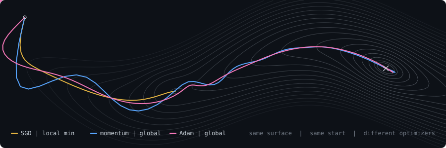
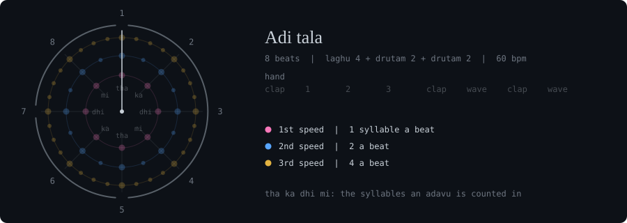

<picture>
  <source media="(prefers-color-scheme: dark)" srcset="assets/descent-dark.svg">
  <source media="(prefers-color-scheme: light)" srcset="assets/descent-light.svg">
  
</picture>

  

<picture>
  <source media="(prefers-color-scheme: dark)" srcset="assets/name-dark.svg">
  <source media="(prefers-color-scheme: light)" srcset="assets/name-light.svg">
  
</picture>

Final-year CS undergrad &nbsp;|&nbsp; GPA 9.25/10 &nbsp;|&nbsp; two papers in progress

[Portfolio](https://nandini1612-github-io.vercel.app/) &nbsp;|&nbsp; [LinkedIn](https://www.linkedin.com/in/nandini-saxena1111) &nbsp;|&nbsp; [Medium](https://medium.com/@nandinisaxenawork) &nbsp;|&nbsp; [Email](mailto:nandinisaxenawork@gmail.com)

[Research](#research) &nbsp;|&nbsp; [Projects](#projects) &nbsp;|&nbsp; [Stack](#stack) &nbsp;|&nbsp; [Outside tech](#outside-tech)

---

I like problems where the first answer is probably wrong. So far that has mostly meant **time series and tabular ML**: drones losing GPS, fraud, cash flow, synthetic data. I am still widening that. What stays the same is how I work: leakage-free splits, ablations, significance tests, and finding out which part of a model actually earns its keep. Then I ship it as something that runs: an API, a pipeline, a live demo.

## Research

**Predicting UAV Velocity through GPS outages using Yaw-rate-gated Deep Learning Models** &nbsp;|&nbsp; [preprint](https://doi.org/10.5281/zenodo.22853978) &nbsp;|&nbsp; [code](https://github.com/nandini1612/gateio) 
When GPS drops out, a drone has to guess where it is from inertial data alone. GateIO predicts the *change* from the last known velocity, with a gate that holds course on straight flight and lets the model learn on turns. Under leave-one-flight-out evaluation it ends a 10 s outage **11.2 m** off on average, about **7.5× closer than a tuned EKF** and roughly 10× closer on turns.

<picture>
  <source media="(prefers-color-scheme: dark)" srcset="assets/outage-dark.svg">
  <source media="(prefers-color-scheme: light)" srcset="assets/outage-light.svg">
  
</picture>

The problem, simulated: GPS cuts out, the aircraft turns, and holding the last velocity can't follow. The bars are measured results from the paper.

**Velocity Features Are Redundant on Real Fraud Data** &nbsp;|&nbsp; [code](https://github.com/nandini1612/fraud-detection) 
Rolling-window "velocity" features are a fraud-detection staple and rank high on importance plots. Under temporal cross-validation and capacity-matched ablations on IEEE-CIS, they add nothing once graph features are present (p = 0.23). The graph / shared-entity features are what moves AUPRC (0.545 → 0.576, p = 0.002), with a cross-dataset check on Elliptic Bitcoin.

## Projects

| | | |
|---|---|---|
| **[GateIO](https://github.com/nandini1612/gateio)** | LSTM and TCN + attention backbones for GPS-outage dead reckoning, benchmarked against EKF, constant-velocity and RoNIN | 11.2 m drift vs 99.5 m (EKF) |
| **[Fraud Detection](https://github.com/nandini1612/fraud-detection)** | Calibrated LightGBM behind FastAPI: SHAP explanation per decision, Prometheus metrics, input-drift monitoring | AUPRC +0.031, p = 0.002 |
| **[CashPulse](https://github.com/nandini1612/finance-health-monitor)** | Cash-flow forecasting and anomaly detection, built twice: a SQLite quickstart and a Postgres, dbt, Airflow and Terraform cloud tier | 54 tests, CI per tier, [live demo](https://finance-health-monitor.streamlit.app/) |
| **[Verity](https://github.com/nandini1612/hierarchical-synthetic-tabular-data-generation)** | Constraint repair for synthetic tabular data. Showed that a popular "utility boost" from k-NN repair is real-data leakage | impossible rows 40% → 0% |
| **Phenological Mismatch Observatory** | Weakly supervised computer vision, evaluated against independent ground-truth data rather than its own labels | |

More experiments in [repositories](https://github.com/nandini1612?tab=repositories).

## Stack

| | |
|---|---|
| **Languages** | Python &nbsp;\|&nbsp; SQL &nbsp;\|&nbsp; Java &nbsp;\|&nbsp; JavaScript &nbsp;\|&nbsp; C |
| **ML and deep learning** | PyTorch &nbsp;\|&nbsp; scikit-learn &nbsp;\|&nbsp; LightGBM &nbsp;\|&nbsp; XGBoost &nbsp;\|&nbsp; Hugging Face Transformers |
| **Models** | LSTM &nbsp;\|&nbsp; TCN &nbsp;\|&nbsp; attention &nbsp;\|&nbsp; gradient boosting &nbsp;\|&nbsp; anomaly detection |
| **Evaluation** | temporal cross-validation &nbsp;\|&nbsp; ablation studies &nbsp;\|&nbsp; significance testing &nbsp;\|&nbsp; SHAP |
| **Backend** | FastAPI &nbsp;\|&nbsp; Flask &nbsp;\|&nbsp; Spring Boot |
| **Data** | PostgreSQL &nbsp;\|&nbsp; dbt &nbsp;\|&nbsp; Apache Airflow |
| **Infrastructure** | Docker &nbsp;\|&nbsp; GitHub Actions &nbsp;\|&nbsp; Terraform &nbsp;\|&nbsp; AWS &nbsp;\|&nbsp; Git |

## Outside tech

**On stage.** Trained in Bharatanatyam, and I anchor events, so I'm comfortable in front of a crowd with or without a script.

**With my hands.** Art and craft, mostly. It's the one place where nothing needs a validation split.

**Reading and volunteering.** These keep me pointed at things bigger than my own projects.

**German.** Working towards B1, one case ending at a time.

**Writing.** Notes on what I'm learning in ML and CS, on [Medium](https://medium.com/@nandinisaxenawork).

 

<picture>
  <source media="(prefers-color-scheme: dark)" srcset="assets/tala-dark.svg">
  <source media="(prefers-color-scheme: light)" srcset="assets/tala-light.svg">
  
</picture>

Adi tala, the 8-beat cycle Bharatanatyam adavus are counted in, played in real time at 60 bpm, at all three speeds.

Happy to talk about ML research, evaluation methodology, or any problem where the obvious metric is lying.

 

Header: SGD, momentum and Adam on one loss surface, same start, one optimizer step per frame. Every figure here is computed, not drawn, by <a href="scripts/">standard-library Python scripts</a>.

